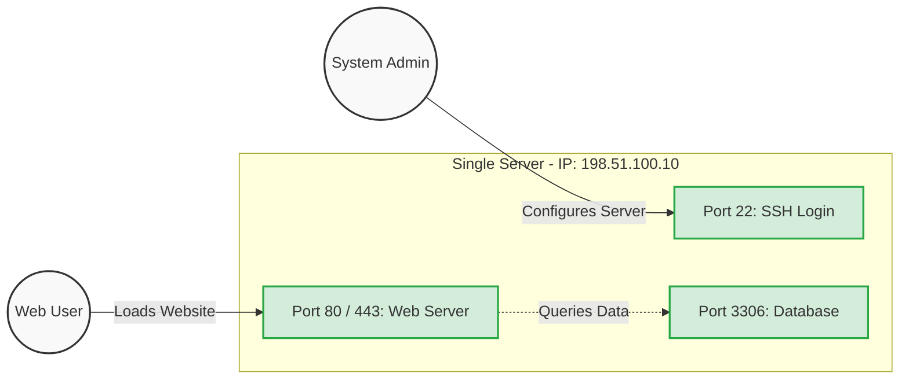
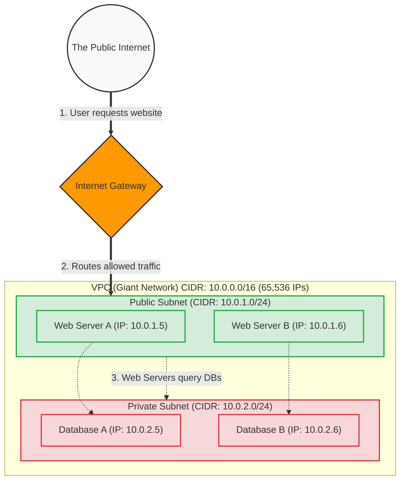

# The Beginner's Guide to IP Addresses, Subnets, Ports, and CIDR

Welcome! If you are learning about cloud computing or networking, terms like IP, Subnet, CIDR, and Ports can sound like a foreign language. This guide breaks them down step-by-step using simple analogies, visual flowcharts, and easy math formulas.

## 1. IP Addresses (Internet Protocol Address)

### ❓ What is it?
An IP address is a unique string of numbers assigned to every device connected to a network.
* **Analogy:** It is exactly like the **mailing address** of your house. Just like the post office needs your address to deliver a package, the internet needs your IP address to deliver data.

### 🛑 The Problem it Solves
Without IP addresses, computers would have no way to identify each other or know where to send information. It solves the problem of **identification and location** on a massive network.

## 2. Subnets (Sub-networks)

### ❓ What is it?
A subnet is a smaller, segmented piece of a larger network.
* **Analogy:** Imagine a giant company building with 10,000 employees in one massive room. It would be chaotic! So, you build walls to create departments (HR, IT, Sales). A subnet is the network equivalent of building those walls.

### 🛑 The Problem it Solves
If thousands of computers are on one giant network, they all "shout" at each other, causing network jams and security risks. Subnetting solves **network congestion and security vulnerabilities**.

## 3. CIDR (Classless Inter-Domain Routing)

### ❓ What is it?
CIDR uses a "slash" notation (like `/24`) to define exactly how many IP addresses a network gets.
* **Analogy:** Imagine buying land. In the old days, you could only buy fixed sizes: 250 acres or 65,000 acres. If you only needed 500, you wasted the rest! CIDR lets you carve out the *exact* size of land you need.

### 🛑 The Problem it Solves
CIDR solved **IP address exhaustion** by allowing flexible, exact-sized networks instead of wasting thousands of unused IPs.

## 4. How to Calculate CIDR and IP Ranges (The Math)

To calculate how many IPs you get from a CIDR block, you just need to remember that an IPv4 address has **32 bits** total.

### 🧮 The Formula:
1. **Find Host Bits:** `32 - [CIDR Number] = [Host Bits]`
2. **Find Total IPs:** `2 ^ [Host Bits] = [Total IPs]`
3. **Find Usable IPs:** `[Total IPs] - 2 = [Usable IPs]` *(We subtract 2 because the first IP is reserved for the Network Name, and the last is reserved for the Broadcast address).*

### 📝 Example: Calculating a `/28` Subnet
Let's say your cloud provider gives you a `10.0.0.0/28` network. How many usable servers can you put in it?
1. **Host Bits:** `32 - 28 = 4 bits`
2. **Total IPs:** `2 ^ 4 = 16 total IPs` (2 x 2 x 2 x 2)
3. **Usable IPs:** `16 - 2 = 14 usable IPs`
   *Result: You can connect exactly 14 devices to this subnet.*

## 5. Ports & Firewalls (The Application Doors)

### ❓ What is it?
If an IP address gets you to the right server, a **Port** gets you to the right application running on that server. Ports are virtual connection points represented by a number from 0 to 65535.
* **Analogy:** If the IP address is an apartment building's street address, the Port is the specific **apartment number** inside that building.

### 🛑 The Problem it Solves
A single server often does multiple things simultaneously (hosts a website, receives emails, runs a database). Ports allow one server with one IP address to run dozens of different services without getting confused about where incoming data should go.

### 🛠️ Common Ports to Know:
* **Port 80:** HTTP (Unencrypted Web Traffic)
* **Port 443:** HTTPS (Secure Web Traffic)
* **Port 22:** SSH (Secure Admin Login)
* **Port 3306:** MySQL Database Default

### 📊 Port Routing Diagram

## 6. The Big Picture: Master Connected Diagram

Here is how external traffic flows into your network, gets routed by CIDR blocks to specific subnets, and reaches individual IP addresses.

## 7. Practice Test: Check Your Knowledge

Test your skills! Write down your answers before scrolling to the Answer Key.

**Question 1:** If you are given a `/24` CIDR block, how many *total* IP addresses do you have?
**Question 2:** Using the formula, how many *usable* IP addresses are in a `/29` subnet?
**Question 3:** Why do we always subtract 2 when calculating *usable* IP addresses?
**Question 4:** If you want a subnet with exactly 1 usable IP address, what CIDR block do you use?
**Question 5:** You want to run a web server that accepts encrypted traffic, but you don't want anyone to log into it remotely. Which port do you open on your firewall, and which one do you make sure is closed?

### ✅ Answer Key

1. **Answer 1:** 256 total IPs. *(Calculation: 32 - 24 = 8. 2^8 = 256).*
2. **Answer 2:** 6 usable IPs. *(Calculation: 32 - 29 = 3. 2^3 = 8 total IPs. 8 - 2 = 6 usable).*
3. **Answer 3:** The very first IP in the block is always reserved to identify the Network itself, and the very last IP is reserved as the Broadcast address for all devices in that subnet.
4. **Answer 4:** A `/32`. *(Calculation: 32 - 32 = 0. 2^0 = 1 total IP).*
5. **Answer 5:** You would open **Port 443** (HTTPS) and ensure **Port 22** (SSH) is closed.